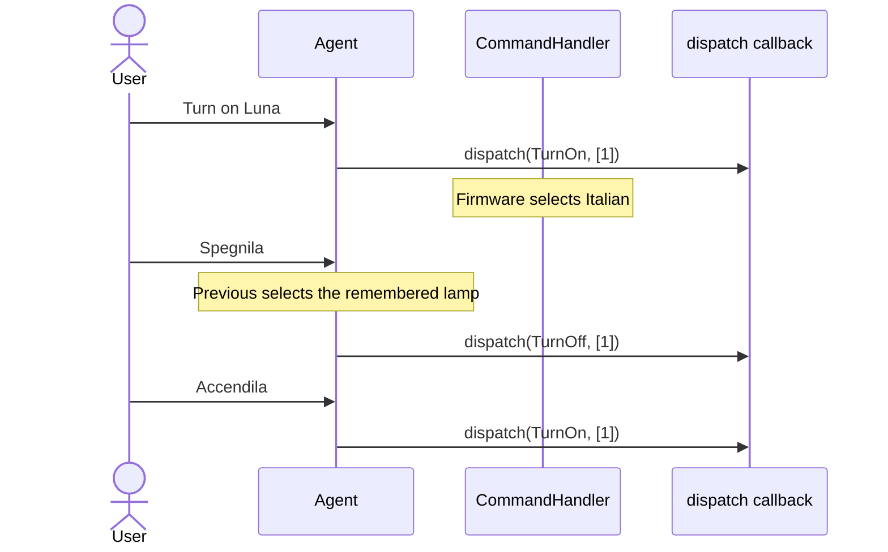

# Switching languages

A device with a language setting must recognize commands in the selected language.
`vocabulary!` declares the phrases of a language, and `set_vocabulary` selects
one while a conversation is running.

## What it is good for

In Italian, a single word such as “Spegnila” says both the action and “the lamp
we just talked about”. A vocabulary can declare such a whole phrase as a
reference to the previous target. The agent keeps the conversation memory when
the language changes, so “Spegnila” turns off the lamp that an English command
selected.

The Rust blocks below are excerpts from the [complete runnable example][example].
From the repository root, run the vocabulary integration tests:

```sh
just test '--test vocabulary'
```

## Declare the commands once

The action enum and the catalog do not change with the language. The derive
provides the default vocabulary, which is English here.

```rust
{{#include ../../crates/esp-agent/tests/vocabulary.rs:actions}}
```

```rust
{{#include ../../crates/esp-agent/tests/vocabulary.rs:catalog}}
```

## Add a vocabulary per language

A vocabulary maps phrases to the same actions. An `explicit` pattern names its
target with `{target}`. A `previous` phrase has no target and refers to the last
one.

```rust
{{#include ../../crates/esp-agent/tests/support/italian_vocabulary.rs:italian}}
```

Target lookups still use the shared [catalog normalization](reference/turn-macros.md#normalization),
which ignores ASCII case and one leading “the”, but does not strip Italian “il”
or “la”. To capture only the name from “Accendi la Luna”, replace
`"accendi {target}"` with `"accendi la {target}"`. Do not use both patterns: they
would both match that input, so the parser would reject it as ambiguous.
Catalog names and groups are shared by every language, which is why “salotto”
sits next to “living room”.

## Switch during a conversation

Start with the English vocabulary from `Vocabulary::derived()`. Call
`set_vocabulary` on the handler between turns.

```rust
{{#include ../../crates/esp-agent/tests/vocabulary.rs:switch}}
```

`set_vocabulary` replaces the language instead of adding one, so the English line
is `Unrecognized` after the switch. Call
`handler.set_vocabulary(Vocabulary::derived())` to restore the derived patterns.



## What a follow-up does

The agent decides what “previous” means from its memory, in every language.

| Remembered targets | Outcome                            |
| ------------------ | ---------------------------------- |
| One lamp           | `Executed` on that lamp            |
| Several lamps      | `Clarify`, so the user chooses one |
| None               | `NeedTarget`; repeat with a target |

After `NeedTarget`, repeat the command with an explicit target: “Spegni Luna”
rather than just “Luna”. There is no pending question for a bare target name
to answer.

## Languages built at run time

`vocabulary!` compiles a language into the firmware. A `RuntimeVocabulary` is
built from plain strings instead, so the phrases can come from a settings file,
a coordinator on the network, or a table in your code, and a new language does
not need a new firmware. Insert the phrases of each language and keep the
results in a map keyed by language code:

```rust
{{#include ../../crates/esp-agent/tests/discovered_devices.rs:languages}}
```

The first argument of each insertion is the name of an enum variant with at
least one `#[command]`, compared case-sensitively. An insertion that fails
returns a `VocabularyError` and leaves the vocabulary unchanged.

To change language, give the handler a copy of the vocabulary:

```rust
if let Some(words) = languages.get("it") {
    handler.set_vocabulary(words.clone());
}
```

The conversation memory survives the switch, so “Spegnila” still turns off the
lamp an English command selected. Every vocabulary in the map stays in memory,
so drop the languages the device does not offer.

The [vocabularies reference](reference/vocabularies.md) lists the matching rules,
the memory limits, and every error. The
[discovered devices example](turns.md#example-with-discovered-devices) uses this
map in a complete conversation.

[example]: https://github.com/veeso/esp-agent/blob/main/crates/esp-agent/tests/vocabulary.rs
