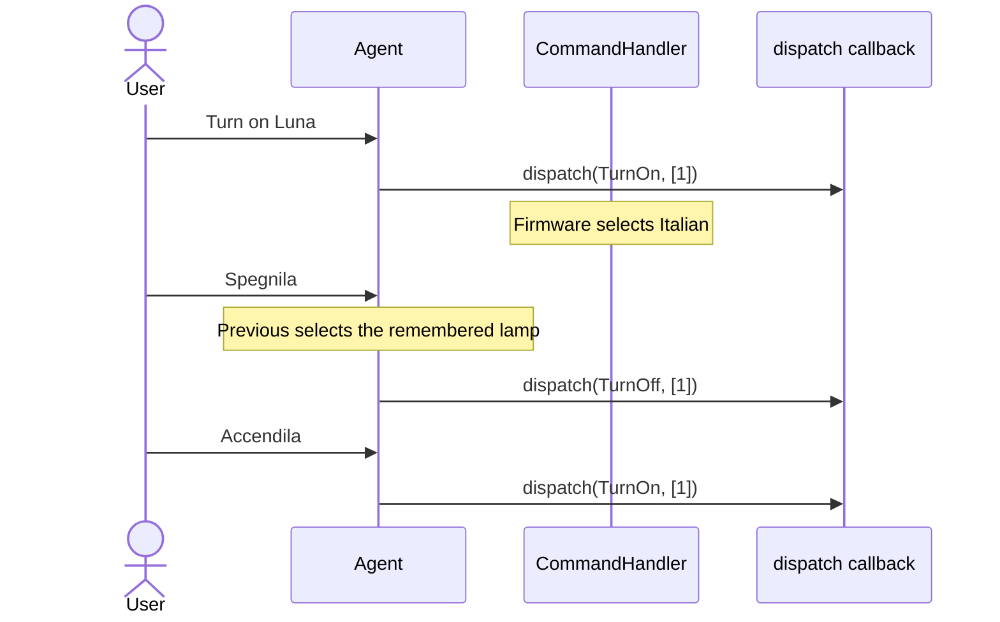

# Switching languages

A device with a language setting must recognize commands in the selected language.
`vocabulary!` declares the phrases of a language, and `set_vocabulary` selects
one while a conversation is running.

## What it is good for

In Italian, a single word such as “Spegnila” says both the action and “the lamp
we just talked about”. A vocabulary can declare such a whole phrase as a
reference to the previous target. The agent keeps the conversation memory when
the language changes, so “Spegnila” turns off the lamp that an English command
selected.

The Rust blocks below are excerpts from the [complete runnable example][example].
From the repository root, run the vocabulary integration tests:

```sh
just test '--test vocabulary'
```

## Declare the commands once

The action enum and the catalog do not change with the language. The derive
provides the default vocabulary, which is English here.

```rust
{{#include ../../crates/esp-agent/tests/vocabulary.rs:actions}}
```

```rust
{{#include ../../crates/esp-agent/tests/vocabulary.rs:catalog}}
```

## Add a vocabulary per language

A vocabulary maps phrases to the same actions. An `explicit` pattern names its
target with `{target}`. A `previous` phrase has no target and refers to the last
one.

```rust
{{#include ../../crates/esp-agent/tests/support/italian_vocabulary.rs:italian}}
```

Target lookups still use the shared [catalog normalization](reference/turn-macros.md#normalization),
which ignores ASCII case and one leading “the”, but does not strip Italian “il”
or “la”. To capture only the name from “Accendi la Luna”, replace
`"accendi {target}"` with `"accendi la {target}"`. Do not use both patterns: they
would both match that input, so the parser would reject it as ambiguous.
Catalog names and groups are shared by every language, which is why “salotto”
sits next to “living room”.

## Switch during a conversation

Start with the English vocabulary from `Vocabulary::derived()`. Call
`set_vocabulary` on the handler between turns.

```rust
{{#include ../../crates/esp-agent/tests/vocabulary.rs:switch}}
```

`set_vocabulary` replaces the language instead of adding one, so the English line
is `Unrecognized` after the switch. Call
`handler.set_vocabulary(Vocabulary::derived())` to restore the derived patterns.



## What a follow-up does

The agent decides what “previous” means from its memory, in every language.

| Remembered targets | Outcome                            |
| ------------------ | ---------------------------------- |
| One lamp           | `Executed` on that lamp            |
| Several lamps      | `Clarify`, so the user chooses one |
| None               | `NeedTarget`; repeat with a target |

After `NeedTarget`, repeat the command with an explicit target: “Spegni Luna”
rather than just “Luna”. There is no pending question for a bare target name
to answer.

## Languages from a coordinator

A coordinator on the network, such as a hub or a home server, often owns the
household settings, including the language. It can send the phrases too, so a
device learns a new language or a corrected translation without being
reflashed. The firmware builds a `RuntimeVocabulary` from those strings and
installs it with the same `set_vocabulary` call.

The library takes strings, so the wire format is up to the firmware. This
payload is JSON:

```json
{
  "language": "it",
  "phrases": [
    { "action": "TurnOn", "explicit": ["accendi {target}"], "previous": ["accendila"] },
    { "action": "TurnOff", "explicit": ["spegni {target}"], "previous": ["spegnila"] }
  ]
}
```

An `action` is the name of an enum variant that carries at least one
`#[command]`, compared case-sensitively: `TurnOn` is an action and `turnon` is
not. A variant without `#[command]` cannot be reached from the network. The
phrases follow the rules of `explicit` and `previous` phrases above, and
`#[derive(TurnCommands)]` already maps the names to variants.

Insert every phrase and stop at the first problem. This excerpt from the
[run-time vocabulary tests][runtime-example] parses the payload with
`serde_json`, which firmware can swap for any parser:

```rust
{{#include ../../crates/esp-agent/tests/runtime_vocabulary.rs:coordinator}}
```

Build the whole language first, and install it only if every insertion
succeeded. Otherwise keep the current language and report the error to the
coordinator:

```rust
{{#include ../../crates/esp-agent/tests/runtime_vocabulary.rs:runtime_switch}}
```

The conversation memory survives this switch too, so “Spegnila” turns off the
lamp that the English command selected. The new vocabulary replaces the old one,
which is dropped and frees its memory. While you build it, both are in memory.

A payload without any phrase builds an empty vocabulary that recognizes
nothing. Check `RuntimeVocabulary::is_empty` before installing if the device
should refuse it.

### Limit what a payload can take

Inserting never aborts when memory runs out: it returns
`VocabularyError::OutOfMemory`. A vocabulary also holds at most 256 phrases and
16 KiB of phrase text. The byte limit counts text, not heap: each stored phrase
also costs bookkeeping, and a short one can occupy a few hundred bytes, so a
full vocabulary takes far more than its text. Size `max_phrases` for the heap
your firmware can spare. Set tighter or wider bounds with
`RuntimeVocabulary::with_limits`:

```rust
let mut words = RuntimeVocabulary::<Action>::with_limits(VocabularyLimits {
    max_phrases: 64,
    max_bytes: 4 * 1024,
});
```

These bounds cover the vocabulary only. Your transport and parser allocate on
their own, so also cap the size of the payload you accept.

The [vocabularies reference](reference/vocabularies.md) lists the matching rules
and the checks.

[example]: https://github.com/veeso/esp-agent/blob/main/crates/esp-agent/tests/vocabulary.rs
[runtime-example]: https://github.com/veeso/esp-agent/blob/main/crates/esp-agent/tests/runtime_vocabulary.rs
