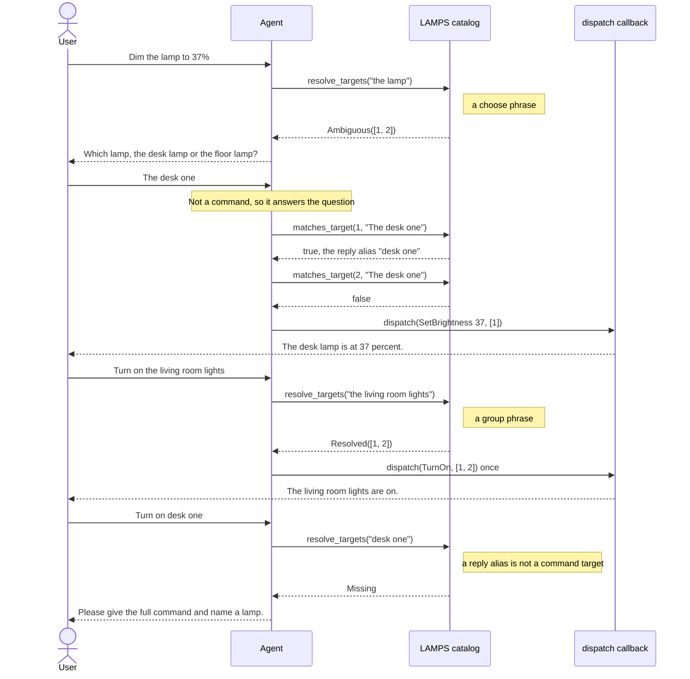

# Turn macros

Three macros declare the vocabulary of a conversation. `targets!` builds a
catalog of devices that are known when the firmware builds. `target!` builds one
device entry for a `DynamicTargetCatalog`, which serves catalogs that come from
the outside world at runtime: a radio scan, a Zigbee or Matter coordinator, or a
configuration fetched over the network. `#[derive(TurnCommands)]` builds a typed
parser for an action enum. Use any of them alone or together. The
[Turns](../turns.md) guide shows how a turn uses them.

## targets!

`targets!` evaluates to a `TargetCatalog` that can initialize a `static`.

```rust
{{#include ../../../examples/semantic-search/src/home.rs:catalog}}
```

| Declaration                               | Meaning                                                                        |
| ----------------------------------------- | ------------------------------------------------------------------------------ |
| `device Name = id, "display name" { .. }` | A device with a stable `TargetId`, a display name, and optional reply aliases. |
| `replies ["alias", ..];`                  | Phrases that pick this device out of a clarification only.                     |
| `choose "phrase" from [Name, ..];`        | A phrase that names several devices, so the agent asks the user to choose one. |
| `group ["phrase", ..] = [Name, ..];`      | Phrases that select every member at once, in one dispatch.                     |

### Three kinds of phrase

- The display name of a device selects that device in a command and in a
  reply. `resolve_targets` returns `Resolved` with its ID.
- A `choose` phrase makes `resolve_targets` return `Ambiguous` with the
  members. A `group` phrase returns `Resolved` with every member. These are the
  two meanings of a selector with several IDs: choose one, or act on all.
- A reply alias is only compared inside `matches_target`, among the devices a
  clarification offered. “Desk one” answers the question but is not a command
  target, so `resolve_targets("desk one")` is `Missing`.

Use `contains_selector(text)` in a handwritten parser to check whether a device
name, choice, or group matches without allocating a target list.

Two devices can share a reply alias. If a reply matches both, the question
stays open. Use `name(id)` to turn a `TargetId` back into its display name.

### How a conversation uses the catalog

The diagram follows the catalog above through the conversation from the
[Turns](../turns.md) guide. The agent asks the catalog about each selector in a
command, and about each reply to a question it asked. Desk is ID 1 and Floor is
ID 2.



A `choose` phrase sends the user back a question, a `group` phrase runs one
dispatch on every member, and a reply alias only works as an answer.

### Normalization

Every lookup compares ASCII case-insensitively after trimming outer whitespace
and trailing sentence punctuation (`.`, `!`, `?`), including whitespace between
trailing marks. It also ignores one leading “the”. “THE DESK LAMP ! ?” therefore
selects the desk lamp. Static declarations and runtime inserts use the same
normalization to reject conflicting selectors.

### Build-time checks

The macro fails the build, pointing at the declaration, for a duplicate ID or
device name, a selector that collides with another after normalization, an
empty selector, a member that is not a declared device or is listed twice, and
a `choose` or `group` with no members. Each group needs at least one phrase.
Each reply alias must contain text after normalization. Devices may share an alias.

## target! and runtime catalogs

When the devices are not known until the firmware runs, build a
`DynamicTargetCatalog` instead. It starts empty, owns its strings, and answers
the same lookups as a `targets!` catalog. `target!` builds one device entry from
the values a discovery result gives you. This snippet goes in firmware that
already declares `extern crate alloc` at its crate root.

```rust,ignore
use alloc::vec::Vec;
use esp_agent::{DynamicTargetCatalog, TurnCommands, target};

let mut catalog = DynamicTargetCatalog::new();
let mut lamp_ids = Vec::new();
let mut room_ids = Vec::new();
for device in coordinator.devices() {
    catalog.insert(target!(device.id, device.name, replies = device.aliases))?;
    room_ids.push(device.id);
    if device.is_lamp {
        lamp_ids.push(device.id);
    }
}
if !lamp_ids.is_empty() {
    catalog.insert_choice("lamp", lamp_ids)?;
}
if !room_ids.is_empty() {
    catalog.insert_group(["living room"], room_ids)?;
}

let mut handler = Action::handler(&catalog, dispatch);
let outcome = agent.turn("turn on desk lamp", &mut handler);
```

If the coordinator reported a device named “desk lamp”, the callback receives its
ID. A reply alias such as “desk one” picks that device during a clarification.

If `TurnCommands` configures a previous-target word, the parser checks it
against the captured target before catalog lookup, ignoring ASCII case and
allowing trailing sentence punctuation with whitespace between the marks.
With `previous = "it"`, `turn on it` refers to the remembered target even if
the catalog contains a device named `it`. `turn on the it` is an explicit
selector and can still find that device. Check discovered device names, choice
phrases, and group phrases against the reserved word before publishing them.

### Arguments

`target!` takes the arguments of `format!`: positional ones first, then named
ones. The positional order is `id`, `name`, `replies`. A raw spelling such as
`r#name` names the same argument as `name`.

| Form                                        | Meaning                                               |
| ------------------------------------------- | ----------------------------------------------------- |
| `target!(id, name)`                         | A device without reply aliases.                       |
| `target!(id, name, replies)`                | A device with reply aliases, all positional.          |
| `target!(id = .., name = .., replies = ..)` | Named arguments, in any order. `replies` is optional. |
| `target!(id, name = .., replies = ..)`      | Positional arguments first, then named ones.          |

A trailing comma is allowed, and each expression is evaluated once, in the order
written. The values can be owned or borrowed. If `aliases` is a `&[&str]`, pass
`replies = aliases.iter().copied()`: the iterator yields `&str` instead of
`&&str`, without cloning the strings at the call site.

| Argument  | Type                                                                                  |
| --------- | ------------------------------------------------------------------------------------- |
| `id`      | `TargetId`.                                                                           |
| `name`    | Anything `Into<String>`: `&str`, `String`, or `&String`.                              |
| `replies` | Any `IntoIterator` of `Into<String>`: an array, a `Vec<String>`, or a `&Vec<String>`. |

### Choices and groups

`insert_choice(phrase, members)` and `insert_group(phrases, members)` are plain
method calls. They keep the distinction between choosing one device and acting on
a whole group, and the members must already be in the catalog.

| Runtime call                   | `targets!` declaration               |
| ------------------------------ | ------------------------------------ |
| `insert(target!(..))`          | `device Name = id, "name" { .. }`    |
| `insert_choice("phrase", ..)`  | `choose "phrase" from [Name, ..];`   |
| `insert_group(["phrase"], ..)` | `group ["phrase", ..] = [Name, ..];` |

To use choices, [enable conversation memory](../turns.md#conversation-memory)
with a `.context(n)` limit large enough to hold every member of the choice.
Otherwise the agent returns `NeedTarget` instead of asking for clarification, so
there is no pending question for a reply alias to answer.

Lookups, normalization, and the three kinds of phrase behave exactly as in
`targets!`. See [Three kinds of phrase](#three-kinds-of-phrase) and
[Normalization](#normalization). `contains_selector`, `matches_target`, and
`name` are available too.

### Runtime checks

Every insertion applies the [build-time checks](#build-time-checks) of
`targets!` when it runs, and reports a `CatalogError`.

| Error                         | Cause                                                         |
| ----------------------------- | ------------------------------------------------------------- |
| `DuplicateId(id)`             | Another device has the ID.                                    |
| `ConflictingSelector(phrase)` | A normalized selector already exists or repeats in this call. |
| `EmptySelector`               | A name or phrase is empty after normalization.                |
| `EmptyReply`                  | A reply alias is empty after normalization.                   |
| `NoPhrases`                   | A group has no phrase.                                        |
| `NoMembers`                   | A choice or group has no member.                              |
| `UnknownMember(id)`           | A member is not a device of the catalog.                      |
| `DuplicateMember(id)`         | A member is listed twice.                                     |

A failed call leaves the catalog unchanged, so the entries from before stay
usable. Mistakes in the argument list of `target!`, such as a missing ID or an
unknown key, remain compile errors.

### Refreshing between turns

To refresh the catalog, drop the handler that borrows it, `remove(id)` the
devices that vanished, `insert` the new ones, and build a new handler. Removing a
device also takes it out of every choice and group, and drops a choice or group
left without members. Inserting a device does not add it to existing choices or
groups. To update membership from discovery, use `clear()` or start a new
catalog, then insert the current devices and recreate the choices and groups
with their updated IDs before building a new handler.

Keep each device's ID stable across refreshes. The agent remembers IDs, not
names. Do not assign a departed device's ID to a different device while a
conversation can still remember it. Start a new conversation before reusing it.

When a command refers to a remembered group, the standard handler drops missing
IDs from the choices it offers. It also drops missing IDs from a pending
question when the user replies. The user must still identify one of the
remaining choices, even if there is only one. If none remain, the agent returns
`NeedTarget` without keeping a pending question.

A previous-target command such as `turn on it` can still send a single remembered
ID to the callback without looking it up again. Before acting, check all IDs against
the current catalog (with `name(id)`) or device registry, and return an error if
any device is missing.

## #[derive(TurnCommands)]

The derive implements `TurnCommands::parse_command` for an enum. Each variant
with `#[command("pattern", ..)]` attributes can be spelled by the user.
Variants without the attribute are skipped so handwritten code can build them.

```rust
{{#include ../../../examples/semantic-search/src/home.rs:examples}}
```

`#[commands(previous = "it")]` on the enum names the word that means the
previous target. Without it, every target is explicit.

### Patterns

A pattern is literals and captures in braces. Literals match ignoring ASCII
case, and `{{` and `}}` write a literal brace.

- `{target}` captures a non-empty slice of the input and becomes
  `TargetSelector::Explicit`, or `Previous` when it equals the configured word.
- `{field}` captures the text of a named field and converts it with the field
  type's `core::str::FromStr`. A value it rejects means the input is not that
  command. Any firmware type works, and its parser owns its cost.

A pattern matches the **whole** input, after trimming outer whitespace and
trailing sentence punctuation. The pattern itself is trimmed the same way, so
`"is {target} on?"` matches “Is the lamp on” and “Is the lamp on?”. Text around a capture is trimmed too. “Dim it to
2% later” is not a command, and neither is “Dim it to 101%” for a `Percent`
that stops at 100.

When a literal such as “ to ” also occurs inside the target, the matcher tries
each possible delimiter and validates typed fields as it goes. A rejected field
skips the remaining captures for that split. “Dim entrée to hall to 100 percent”
captures the target “entrée to hall”. Input that two patterns or two splits both
accept is declined as ambiguous rather than guessed.

### Build-time checks

The derive rejects, with a message pointing at the attribute or field, an
unknown capture name, a field that no capture fills, a pattern with no
`{target}`, a repeated capture, two adjacent captures with no literal between
them, a duplicate pattern in the enum after ignoring case, more than eight
captures, a field named `target`, and a tuple variant. Each `#[command(..)]`
attribute must include at least one pattern.

### The adapter

`Action::handler(&CATALOG, callback)` returns a `TurnHandler` that parses with
the derived parser, looks targets up in the catalog, and forwards dispatch to
`callback`, which keeps your success and error types. The catalog can be a
`TargetCatalog`, a `DynamicTargetCatalog`, or any type that implements
`TargetLookup`. The adapter uses `TargetLookup::target_available` to check
pending choices. The default keeps every choice and is used by `TargetCatalog`.
The adapter ignores the agent's suggestion and always checks the input. For a
handler of your own, call `Action::parse_command` from `parse`, as the
[firmware example](../turns.md#a-question-that-the-firmware-owns) does.

When storing a handler for a local catalog, pass `&catalog` rather than
`&&catalog`. An extra temporary reference cannot outlive the call.
If the catalog is behind a smart pointer, pass `&*catalog`.

## Allocation

The `targets!` and `#[derive(TurnCommands)]` macros compile their syntax on the
build host. On the device, the catalog is read-only data and the parser borrows
its input, so matching allocates nothing. `resolve_targets` returns an owned
list, and so does the agent's `turn`.

A `DynamicTargetCatalog` owns its strings, so inserting allocates. Its lookups
allocate only the returned list, as the static catalog's do.
