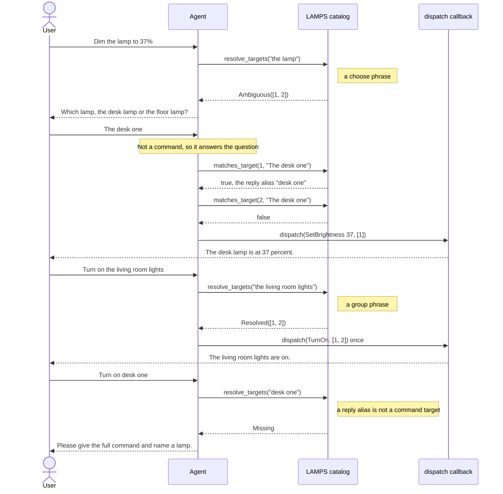

# Turn macros

Two independent macros declare the vocabulary of a conversation. `targets!`
builds a catalog of devices, and `#[derive(TurnCommands)]` builds a typed parser
for an action enum. Use either one alone or both together. The
[Turns](../turns.md) guide shows how a turn uses them.

## targets!

`targets!` evaluates to a `TargetCatalog` that can initialize a `static`.

```rust
{{#include ../../../examples/semantic-search/src/home.rs:catalog}}
```

| Declaration                               | Meaning                                                                        |
| ----------------------------------------- | ------------------------------------------------------------------------------ |
| `device Name = id, "display name" { .. }` | A device with a stable `TargetId`, a display name, and optional reply aliases. |
| `replies ["alias", ..];`                  | Phrases that pick this device out of a clarification only.                     |
| `choose "phrase" from [Name, ..];`        | A phrase that names several devices, so the agent asks the user to choose one. |
| `group ["phrase", ..] = [Name, ..];`      | Phrases that select every member at once, in one dispatch.                     |

### Three kinds of phrase

- The display name of a device selects that device in a command and in a
  reply. `resolve_targets` returns `Resolved` with its ID.
- A `choose` phrase makes `resolve_targets` return `Ambiguous` with the
  members. A `group` phrase returns `Resolved` with every member. These are the
  two meanings of a selector with several IDs: choose one, or act on all.
- A reply alias is only compared inside `matches_target`, among the devices a
  clarification offered. “Desk one” answers the question but is not a command
  target, so `resolve_targets("desk one")` is `Missing`.

Use `contains_selector(text)` in a handwritten parser to check whether a device
name, choice, or group matches without allocating a target list.

Two devices can share a reply alias. If a reply matches both, the question
stays open. Use `name(id)` to turn a `TargetId` back into its display name.

### How a conversation uses the catalog

The diagram follows the catalog above through the conversation from the
[Turns](../turns.md) guide. The agent asks the catalog about each selector in a
command, and about each reply to a question it asked. Desk is ID 1 and Floor is
ID 2.



A `choose` phrase sends the user back a question, a `group` phrase runs one
dispatch on every member, and a reply alias only works as an answer.

### Normalization

Every lookup compares ASCII case-insensitively after trimming outer whitespace
and trailing sentence punctuation (`.`, `!`, `?`), and ignores one leading
“the”. “THE DESK LAMP?!” therefore selects the desk lamp. The macro applies the
same normalization when it checks your declarations.

### Build-time checks

The macro fails the build, pointing at the declaration, for a duplicate ID or
device name, a selector that collides with another after normalization, an
empty selector, a member that is not a declared device or is listed twice, and
a `choose` or `group` with no members. Each group needs at least one phrase.
Each reply alias must contain text after normalization. Devices may share an alias.

## #[derive(TurnCommands)]

The derive implements `TurnCommands::parse_command` for an enum. Each variant
with `#[command("pattern", ..)]` attributes can be spelled by the user.
Variants without the attribute are skipped so handwritten code can build them.

```rust
{{#include ../../../examples/semantic-search/src/home.rs:examples}}
```

`#[commands(previous = "it")]` on the enum names the word that means the
previous target. Without it, every target is explicit.

### Patterns

A pattern is literals and captures in braces. Literals match ignoring ASCII
case, and `{{` and `}}` write a literal brace.

- `{target}` captures a non-empty slice of the input and becomes
  `TargetSelector::Explicit`, or `Previous` when it equals the configured word.
- `{field}` captures the text of a named field and converts it with the field
  type's `core::str::FromStr`. A value it rejects means the input is not that
  command. Any firmware type works, and its parser owns its cost.

A pattern matches the **whole** input, after trimming outer whitespace and
trailing sentence punctuation. The pattern itself is trimmed the same way, so
`"is {target} on?"` matches “Is the lamp on” and “Is the lamp on?”. Text around a capture is trimmed too. “Dim it to
2% later” is not a command, and neither is “Dim it to 101%” for a `Percent`
that stops at 100.

When a literal such as “ to ” also occurs inside the target, the matcher tries
each possible delimiter and validates typed fields as it goes. A rejected field
skips the remaining captures for that split. “Dim entrée to hall to 100 percent”
captures the target “entrée to hall”. Input that two patterns or two splits both
accept is declined as ambiguous rather than guessed.

### Build-time checks

The derive rejects, with a message pointing at the attribute or field, an
unknown capture name, a field that no capture fills, a pattern with no
`{target}`, a repeated capture, two adjacent captures with no literal between
them, a duplicate pattern in the enum after ignoring case, more than eight
captures, a field named `target`, and a tuple variant. Each `#[command(..)]`
attribute must include at least one pattern.

### The adapter

`Action::handler(&CATALOG, callback)` returns a `TurnHandler` that parses with
the derived parser, looks targets up in the catalog, and forwards dispatch to
`callback`, which keeps your success and error types. The adapter ignores the
agent's suggestion and always checks the input. For a handler of your own, call
`Action::parse_command` from `parse`, as the
[firmware example](../turns.md#a-question-that-the-firmware-owns) does.

## Allocation

Both macros compile their syntax on the build host. On the device, the catalog
is read-only data and the parser borrows its input, so matching allocates
nothing. `resolve_targets` returns an owned list, and so does the agent's
`turn`.
